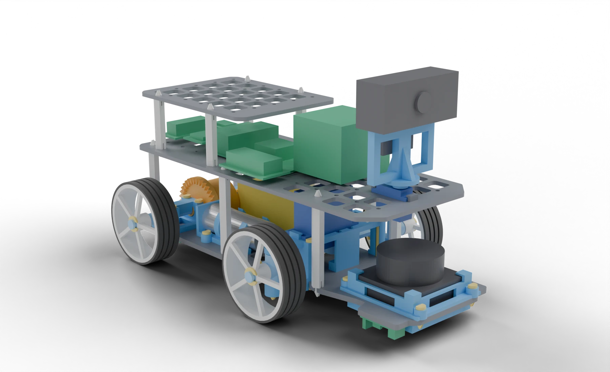
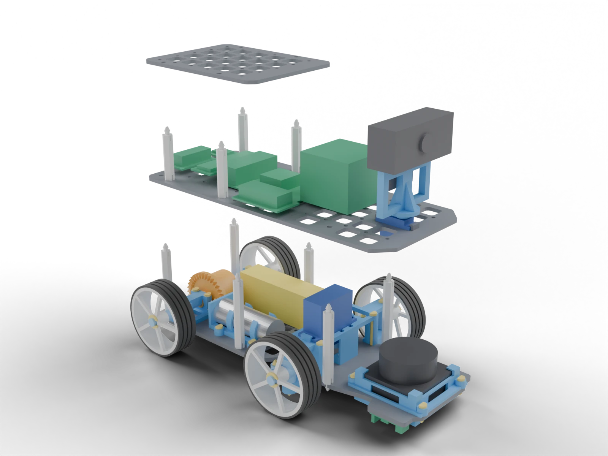
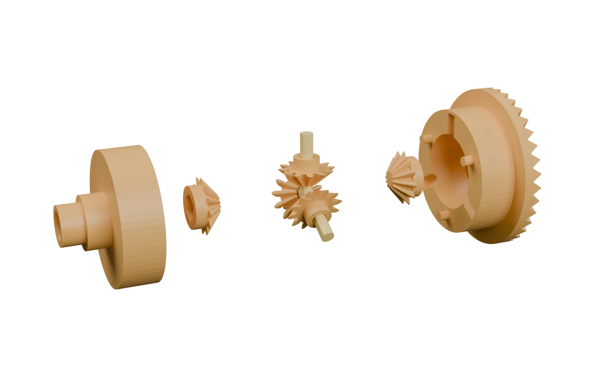
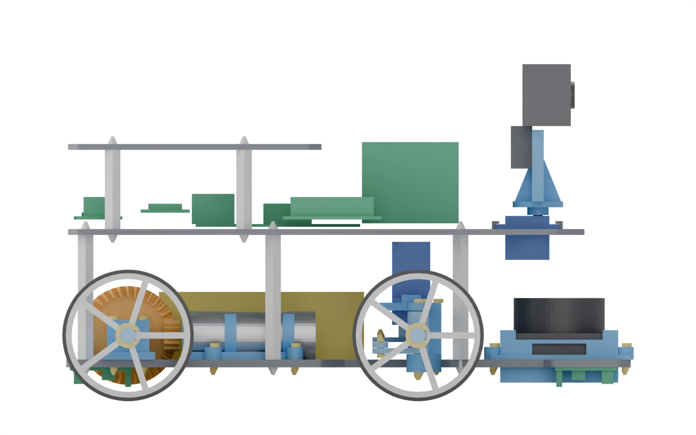
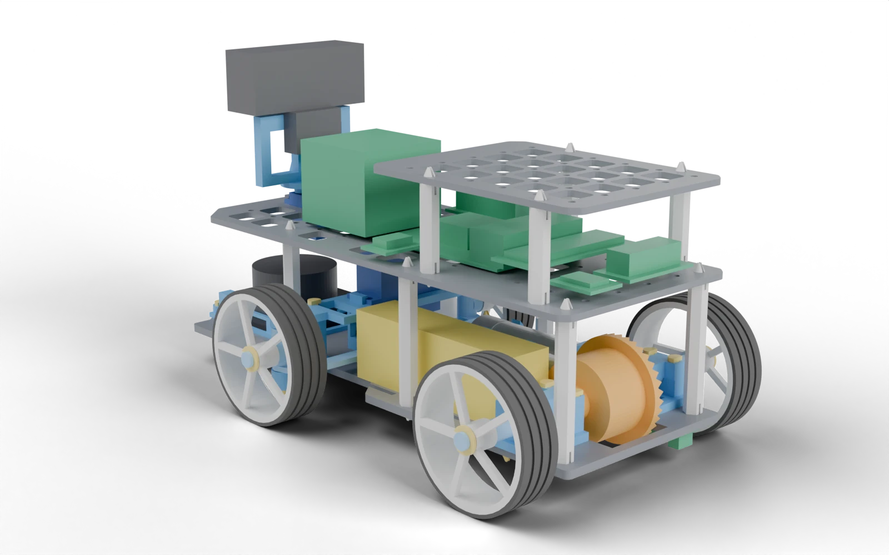

<p align="center">
  
</p>

<h1 align="center">Autonav R1</h1>

<p align="center">
  A screw-free, 3D-printed Ackermann robot for the Autonomous Navigation Challenge.<br>
  Designed by <a href="https://github.com/theretroexe">theretroexe</a>.
</p>

<p align="center">
  <a href="https://theretroexe.github.io/autonav-robot/"><b>Project site</b></a> &nbsp;|&nbsp;
  <a href="https://theretroexe.github.io/autonav-robot/out/robot_viewer.html"><b>Interactive 3D viewer and assembly guide</b></a> &nbsp;|&nbsp;
  <a href="https://github.com/theretroexe/autonav-robot/archive/refs/heads/main.zip">Download everything</a>
</p>

<p align="center">
  
</p>

I designed Autonav R1 to be built by a student team with one Bambu printer and no trip to the hardware store. It steers like a car (Ackermann geometry on an MG996R servo), drives both rear wheels from a single JGA25-370 encoder motor through a printed differential, and carries its RPLIDAR C1 as low and as far forward as the rules allow. Every joint is a printed snap pin or peg; the electronics go on with tape and hot glue.

The whole robot is generated from one parametric Python file, `robot.py`. Every build checks itself: parts can't collide, gears must mesh, the differential has to be assemblable, and the robot has to fit the 300 mm cube.

## At a glance

| | |
|---|---|
| Size | 295.5 x 171 x 174.3 mm with the wheels straight, 193.6 mm wide at full lock (rule: 300 mm cube) |
| Mass | 343 g printed + 867 g electronics = 1210 g (rule: 1500 g) |
| Steering | Ackermann, 31° inner / 21.5° outer lock, within 0.31° of ideal, 452 mm turning radius |
| Drive | JGA25-370 encoder motor, printed crown gear and 3-spider bevel differential, 36:11 |
| Sensing | RPLIDAR C1 (scan plane 41.8 mm off the floor), Logitech Brio 100 on an SG90 pan servo, 2 IR line sensors |
| Brains | Raspberry Pi 4B, ESP32-S3, IBT-2 motor driver |
| Fasteners | None bought: 20 printed snap pins, snap-peg standoffs, printed servo horns |

<table>
  <tr>
    <td width="50%"><br><sub>Three decks: drivetrain and sensors, then the Pi and camera, then a spare top deck.</sub></td>
    <td width="50%"><br><sub>The printed differential: cover, side gears, three spiders on a printed cross, crown-gear case.</sub></td>
  </tr>
  <tr>
    <td width="50%"><br><sub>Side elevation. The lidar sits 4.5 mm inside the 300 mm limit.</sub></td>
    <td width="50%"><br><sub>From the rear: motor, crown gear and the rear axle housing.</sub></td>
  </tr>
</table>

## Build one

1. **Print the fit coupon** (`out/stl/00_FIT_TEST_COUPON_print_first.stl`, PETG). Push its pins into its holes. If they're too tight or too loose, change `FIT` at the top of `robot.py` and rebuild before printing anything else.
2. **Print the eight plates.** Open [`out/autonav_plates.3mf`](out/autonav_plates.3mf) in Bambu Studio; every part is already laid flat. Using another slicer? All parts are in [`out/stl/`](out/stl). Filaments, layer heights and orientation notes are in [`PRINT_PLATES.md`](PRINT_PLATES.md). About 340 g in total: PLA, PETG for gears and pins, TPU for the tyres.
3. **Assemble** with the [3D viewer](https://theretroexe.github.io/autonav-robot/out/robot_viewer.html). It builds the robot in 14 steps, with close-ups of the differential. Have superglue, double-sided tape, hot glue, a rubber band and a little grease ready.

Dimensions for wiring, mounts and software (every part's position in mm) are in [`out/handoff/autonav_robot.md`](out/handoff/autonav_robot.md), with the full assembly as a plain-text model in [`out/handoff/autonav_robot.obj`](out/handoff/autonav_robot.obj). Frame: X right, Y forward, Z up, origin on the floor under the rear axle.

## Changing the design

```
pip install manifold3d trimesh numpy
python robot.py         # parts -> out/stl, checks -> out/report.json
python make_plates.py   # Bambu Studio project -> out/autonav_plates.3mf
python make_handoff.py  # dimension sheet, OBJ and zip -> out/handoff/
python make_viewer.py   # interactive viewer -> out/robot_viewer.html
blender -b --factory-startup -P make_renders.py   # renders -> media/
```

The settings to tune after a test print are at the top of `robot.py`: `FIT` (pin and hole clearance), `SPLINE_FIT` (servo horn grip) and `BACKLASH` (gear play).

## Status

Designed and checked in CAD; not printed or test-assembled yet. Still to measure on real parts: motor RPM, MG996R flange height and the Brio clip. Current-limit the IBT-2: a stalled motor can strip the printed gears.

---

<sub>Autonav R1 © 2026 theretroexe.</sub>
